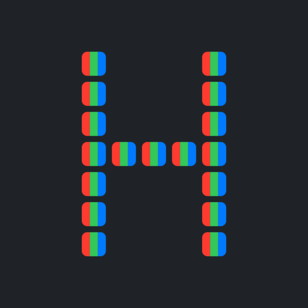

<p align="center">
  
</p>

<h1 align="center">HexVa</h1>

<p align="center">
  A desktop utility for turning file bytes into bitmap images.
  <br>
  <a href="https://github.com/Juromito/HexVa">GitHub repository</a>
</p>

---

HexVa reads a file as binary data and maps its bytes to the pixel values of a square, 24-bit image. Use it to explore the visual patterns hidden in documents, archives, media, and other files.

## Features

- Convert local files within BMP's size limits to **BMP** or **PNG**.
- Preview the generated image and its dimensions.
- Choose **System**, **Light**, or **Dark** appearance.
- Follow conversion progress while the interface stays responsive.
- Keep file processing on your computer; HexVa does not upload source files.

## Example images

These sample BMP files are included in [`examples/`](examples/):

| Example | Dimensions | File |
| --- | ---: | --- |
| Lorem Ipsum | 104 × 104 px | [LoremIpsum.bmp](examples/LoremIpsum.bmp) |
| Music | 2621 × 2621 px | [music.bmp](examples/music.bmp) |

Open an example in an image viewer, or select it as a source file in HexVa.

## Requirements

- Python 3.10 or newer
- PySide6 (installed from `requirements.txt`)

## Install

Clone the repository and open a terminal in the project folder:

```bash
git clone https://github.com/Juromito/HexVa.git
cd HexVa
python -m venv .venv
```

Activate the virtual environment:

```bash
# Linux / macOS
source .venv/bin/activate

# Windows PowerShell
.venv\Scripts\Activate.ps1
```

Install the dependencies:

```bash
python -m pip install -r requirements.txt
```

## Run

```bash
python main.py
```

Choose a source file, select an output format, choose where to save the image, then select **Convert and save**. The result appears in the preview. Theme and format preferences are remembered between launches.

## Output formats

| Format | Description |
| --- | --- |
| **BMP** | Uncompressed 24-bit image. It is simple and widely supported, but usually takes more disk space. |
| **PNG** | Lossless compression of the generated image pixels. Its size depends on the data and may be larger than the BMP for incompressible content. |

## How the conversion works

Bytes are written into the image as three-byte pixel values. The image is square; unused pixels and an incomplete final pixel are padded with zeroes. BMP row padding is added where required by the format.

HexVa is a visualization tool, not an archival or backup format. An output image alone does not contain enough information to reliably reconstruct the original file.

Creating a PNG requires decoding the temporary BMP image in memory. Very large source files may therefore require substantial available memory.

## License

No license has been selected for this repository yet. Add a `LICENSE` file once you have decided how others may use the project.

## Project

[github.com/Juromito/HexVa](https://github.com/Juromito/HexVa)
